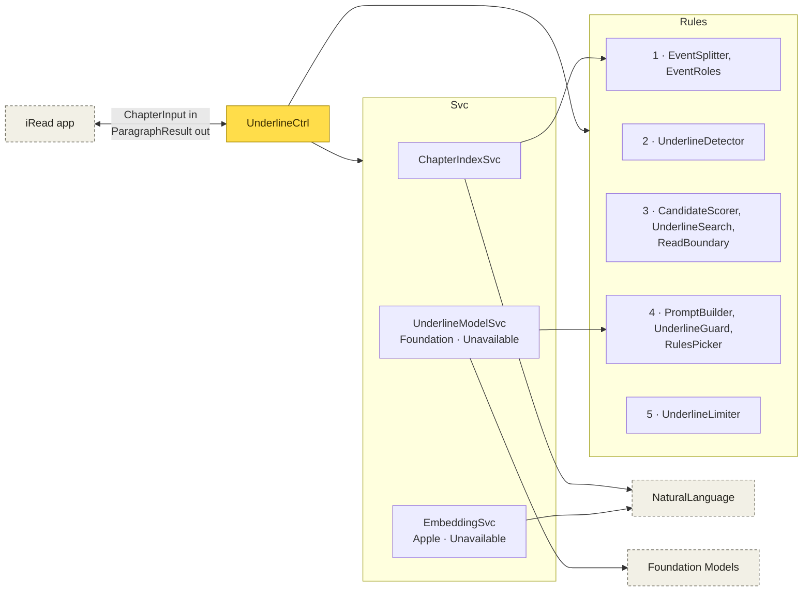

# UnderlineEngine architecture

A Swift package, no UI. Type suffixes follow iRead's (`EReader/iRead/ARCHITECTURE.md`) and TextEngine's, with only the layers this package needs. Folders are numbered after the processes in [docs/DFD.md](docs/DFD.md), so the reading order shows in the tree. They are one module, so a folder is not a dependency boundary.

This page is about types and who calls whom. For how data moves through the pipeline, step by step, see [docs/DFD.md](docs/DFD.md).

## Folders

```
Sources/UnderlineEngine/
  Pipeline/        UnderlineCtrl            the flow starts and ends here: prepare, evaluate a candidate, the chapter, the stream
  1-Prepare/       ChapterIndexSvc          NaturalLanguage (sentences, tags, names) + events + embeddings
                   EmbeddingSvc             NLEmbedding (protocol: Apple, Unavailable)
                   SentenceSplitter, EventSplitter, EventRoles
  2-Detect/        UnderlineDetector        which events and names may get an underline
  3-Search/        CandidateScorer          search, before the underlined sentence only
  4-PickConfirm/   UnderlineModelSvc        Foundation Models (protocol: Foundation, Unavailable) + PromptBuilder
                   UnderlineGuard           same-paragraph check, the phrase's range
                   RulesPicker              rules pick and confirm, when there is no model
  5-Limit/         UnderlineLimiter
  Shared/          ReadBoundary             used by more than one process
                   Models/                  plain data: inputs, indexed chapter, underlines, records
```

## Dependency direction

By type suffix, not by folder:

```
        Ctrl
       /    \
     Svc    Rules
       \    /
       Models
```

The same, with every type, grouped by the [DFD](docs/DFD.md) process they serve. An arrow means "calls". Every box uses `Models`, so those arrows are left out.



- `UnderlineCtrl` calls every `Svc` and every `Rules` group except 1, which only `ChapterIndexSvc` calls. `ChapterIndexSvc` also calls `EmbeddingSvc`, and `UnderlineCtrl` hands both to `SearchQuery.make` to tag and embed each phrase.
- `UnderlineDetector` also calls `EventRoles.reasonClause`.
- `SentenceSplitter` is left out: only `ChapterInput(plainText:)` uses it, for the harness and tests. The app sends its own sentence ranges.
- `Rules` types depend only on `Models` and on each other, so each can be tested without a framework.

## The rule

- Dependencies point down: `Ctrl → Svc → Models`. `Rules` can be called from anywhere.
- A type depends on about 3 things. `UnderlineCtrl` gets `ChapterIndexSvc`, `EmbeddingSvc`, `UnderlineModelSvc`.
- A protocol only when a test needs one: `UnderlineModelSvc` (the scripted fake in tests, the rules path) and `EmbeddingSvc` (words-only search).
- Every sentence a step may use comes through `ReadBoundary.searchable(before:)`. Nothing at or after the underlined sentence is scored, sent to the model, or kept as a reference.
- The model never searches or picks. It only says yes or no to the one sentence search ranked first.
- Only the types the app needs are `public`. Names don't clash with iRead's (`IndexedSentence`, not `Sentence`).
- File name = main type; a type split over files uses `Type+Part.swift`. Tuning values live in a `…Knobs` enum at the top of the file that uses them.

## What the suffixes mean

| Suffix | Job |
|---|---|
| `Ctrl` | One use case, orchestrating services and rules. |
| `Svc` | Wraps a framework API (NaturalLanguage, Foundation Models). |
| `Rules` | Pure functions, no state, no I/O. |
| `Models` | Plain data. |

## Main flow

The numbers in brackets are the processes in [docs/DFD.md](docs/DFD.md).

1. [1] `UnderlineCtrl.prepare(ChapterInput)` → `ChapterIndexSvc.prepare` → `IndexedChapter` (sentences, tags, events, vectors).
2. Per paragraph (`UnderlineCtrl.pass`): [2] `UnderlineDetector.candidates` → for each, `UnderlineCtrl.evaluate`: [3] `CandidateScorer.rank(before:)` → `UnderlineSearch.candidates` → [4] top candidate (or `RulesPicker.decide`) → `UnderlineGuard.isInSameParagraph` → `UnderlineModelSvc.confirm` (or `RulesPicker.confirm`) → `UnderlineGuard.paragraphRange`.
3. [5] `UnderlineLimiter.apply` on the paragraph's kept underlines.
4. `paragraphResults(in:startingAt:)` runs the per-paragraph pass from the reader's paragraph, then wraps. The harness runs the same pass on the golden items' paragraphs only (`underlines(paragraphsHolding:in:)`).
