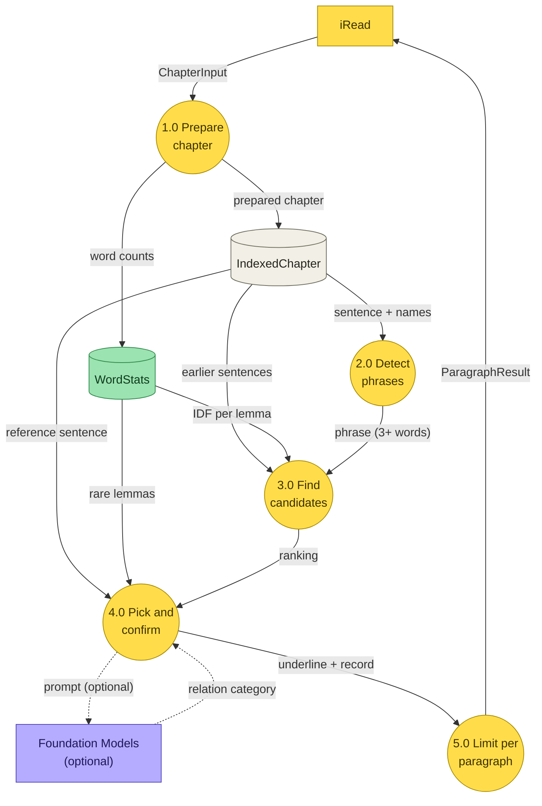
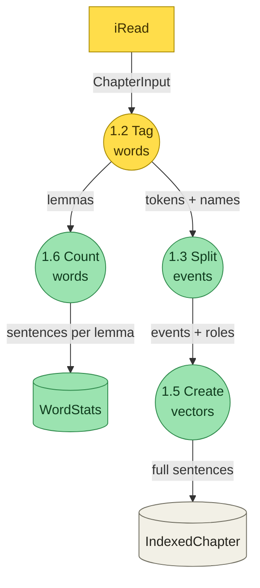
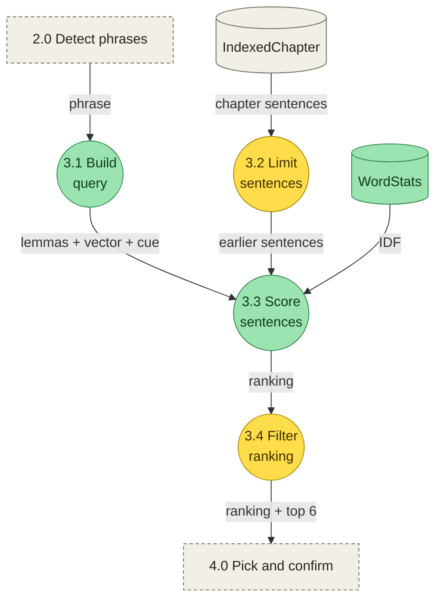
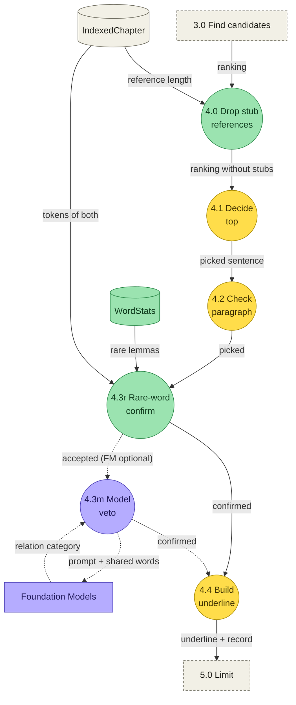

# UnderlineEngine DFD v2 (branch `link-quality`, November 2026)

Second version of [DFD.md](DFD.md): the engine's data flow as it is **now**, with the rules path as the default, and what changed since release 1.1.0. Notation as in v1: box = external entity, circle = process, cylinder = data store, arrow = data flow.

Colours: yellow = rules and formulas, purple = Foundation Models, green = **new in v2**.

- [Level 1](#level-1-five-processes)
- [1. Prepare](#1-prepare-chapter)
- [2. Detect](#2-detect-phrases)
- [3. Search](#3-find-candidates)
- [4. Pick and confirm](#4-pick-and-confirm)
- [5. Limit](#5-limit-per-paragraph)
- [Changes since 1.1.0](#changes-since-release-110)
- [Harness only, not yet in the app](#harness-only-not-yet-in-the-app)

## Level 1: five processes

Main differences from v1:

- **New data store, `WordStats`**: the number of sentences that contain each content lemma. Read by process 3 (IDF word weights) and process 4 (is a shared word rare).
- **Process 4 is no longer model-driven.** Rules pick and confirm on every path. Foundation Models is an optional veto on links the rules already accepted (dashed arrows).

| Process | Question | In | Out |
|---|---|---|---|
| 1. Prepare | What is in each sentence, and how common is each word? | `ChapterInput` | `IndexedChapter` + `WordStats` |
| 2. Detect | Which phrases are underline candidates? | sentence | phrases of 3+ words |
| 3. Search | Which earlier sentences are most similar? | phrase, earlier sentences, IDF | ranking |
| 4. Pick + confirm | Is the top sentence really linked? | ranking, reference sentence, rare lemmas | underline or drop reason |
| 5. Limit | Which underlines are shown? | one paragraph's underlines | `ParagraphResult` |

## 1. Prepare chapter

Steps 1.1 (validation) and 1.4 (story role) are unchanged from v1 and not drawn. (The event-indexing tracks and the underline kind were removed for the R22 experiment and kept for the R8 release; see result.md.)

| Step | What happens | Code | Changed |
|---|---|---|---|
| 1.2 | Lemma, word class and person/place names (`NLTagger`) | `ChapterIndexSvc.tag` | no |
| 1.3 | Split sentences into events. **New:** an event never ends on "a/an/the" or on an adjective cut from its noun, and the subject of the next clause is not glued onto the previous event | `EventSplitter.endsInsideNounPhrase`, `startsCoordinatedSubject` | **yes** |
| 1.5 | One meaning vector per sentence: `NLEmbedding`, or **`NLContextualEmbedding`** (token vectors mean-pooled, centred on the mean of a fifth of the book's sentences, rescaled to NLEmbedding's range) | `EmbeddingSvcApple`, `EmbeddingSvcContextual` | **yes** |
| 1.6 | **New.** Count the sentences that hold each content lemma. `idf = ln(1 + N / df)`. A lemma is rare when it occurs in ≤ 0.4% of sentences (minimum 2) | `WordStats` | **new** |

`NLContextualEmbedding` needs model assets that the system downloads on first use (`requestAssets`); `EmbeddingSvcContextual.make()` returns `nil` when they cannot be loaded.

## 2. Detect phrases

| Step | What happens | Changed |
|---|---|---|
| 2.1 Events | At least 3 words, not only general words, and (for cause/goal) not explained by a "because…" clause in the same sentence | no |
| 2.2 Names | **Names also need 3+ words**: "Jo" or "Mrs. March" alone is never underlined. The "skip if mentioned in the last 30 sentences" rule still applies | **yes** |
| 2.3 Combine | Events, then names, each as an `UnderlineCandidate` | no |

Code: [`UnderlineDetector.swift`](../Sources/UnderlineEngine/2-Detect/UnderlineDetector.swift), knob `UnderlineKnobs.minPhraseWords = 3`.

## 3. Find candidates

| Step | What happens | Changed |
|---|---|---|
| 3.1 | Query: content lemmas, the phrase's vector (phrase text only), person names, reaction cue. **New:** a reaction cue anywhere in the sentence ("then", "immediately", or an event with the reaction role) applies to every event in that sentence | **yes** |
| 3.2 | Only sentences before the phrase, in the same chapter (`ReadBoundary`) | no |
| 3.3 | Score = 0.65 × meaning + 0.35 × shared words + bonuses. **New:** shared words are IDF-weighted ("limes" counts far more than "want"); contextual cosine is mapped with `0.703 × cos + 0.295` | **yes** |
| 3.4 | Drop raw scores < 0.35, keep the top 6 | no |

Code: [`CandidateScorer.swift`](../Sources/UnderlineEngine/3-Search/CandidateScorer.swift).

## 4. Pick and confirm

Steps 4.0–4.3r always run. **The default is rules only** (`ModelChoice.rulesOnly`). Foundation Models is optional (`ModelChoice.automatic`): when chosen and available, it reviews links the rules **already accepted** (4.3m) and can only reject, never add.

| Step | What happens | Code | Drops as |
|---|---|---|---|
| 4.0 | **New.** Remove stub references from the ranking: ≤ 3 tokens ("Jo!"), or ≤ 6 tokens starting with a speech verb ("cried Amy.") | `UnderlineGuard.isStub` | |
| 4.1 | Take the top candidate when its raw score is ≥ **0.60** (was 0.70) and ≥ 0.05 above the second | `RulesPicker.decide`, `JudgeKnobs` | `pickedNone` |
| 4.2 | The reference must be in another paragraph | `UnderlineGuard.isInSameParagraph` | `explainedInParagraph` |
| 4.3r | **New.** Phrase and reference must share, with the same word class: (a) a rare noun or adjective, (b) two rare lemmas of any class, or (c) the same person name. A rare verb alone is not enough. | `RulesPicker.confirm`, `WordStats.isRare` | `confirmRejected` |
| 4.3m | **Optional.** Foundation Models gets the sentence, phrase, reference (cut to 150 words) and the shared words ("Words in both: flask"), names what the phrase refers to, and picks `sameThing`, `sameEvent`, `causeOrGoal`, `onlySameWord` or `unrelated`. The first three keep the link | `UnderlineModelSvcFoundation`, `ModelKnobs` | `confirmRejected`, `modelFailed` |
| 4.4 | Map the phrase range into paragraph coordinates and build the `Underline` | `UnderlineGuard.paragraphRange` | `guardRejected` |

Example for 4.3r: "had got twenty-four delicious **limes**" → "I haven't tasted a **lime** this week" shares a rare noun, so it passes. "was **frightened**" → "she **frightened** him" shares only one verb, so it is rejected.

Why FM is not the default: in a script test on the first three chapters, the model rejected right and wrong links about equally often with every prompt tried ("explains", "linked", category + anchor words + examples), so it removed right links without filtering well, and it was ~10× slower.

## 5. Limit per paragraph

**Changed: no per-paragraph cap** (`maxPerParagraph = Int.max`). A paragraph can show several underlines. Only two overlapping phrases in the same sentence are still prevented; the lower-scored one is recorded as `densityLimit`. A reference in the phrase's own paragraph is still dropped at 4.2 (`explainedInParagraph`).

Rationale: on the full Little Women run, the 147 underlines the old cap of 1 removed were as often right as the ones shown (R7 52.6% → R8 52.0%, +72 right links). Runtime is unaffected because the cap is applied after every phrase has been evaluated.

## Changes since release 1.1.0

| | Release 1.1.0 | v2 |
|---|---|---|
| Data stores | `IndexedChapter` | + `WordStats` |
| Embedding | `NLEmbedding` | `NLEmbedding` or `NLContextualEmbedding` |
| Phrase length | events ≥ 3 words, names 1+ words | everything ≥ 3 words |
| Word weight in the score | uniform | IDF |
| Rules score threshold | 0.70 | 0.60 |
| Rules confirm | shared word or related role | shared rare word (≤ 0.4% of sentences) with the same word class, or the same name |
| Stub references | allowed | dropped |
| Underlines per paragraph | at most 1 | unlimited (no overlap) |
| Foundation Models | decides pick and confirm | optional veto after rules; off by default |

Full-book results (Claude's verdicts on every underline; see [result.md](result.md)):

| | Underlines | Right |
|---|---|---|
| iRead seed today (release engine, model path), Little Women | 1,826 | ≈10% (40-item sample) |
| v2 rules, Little Women (R8) | 831 | **52.0%** |
| v2 rules + sense check, Pride and Prejudice (R12) | 352 | **59.7%** |

## Harness only, not yet in the app

Bumping the engine pin in iRead is not enough to get the numbers above. Three things still differ in the app:

1. **Path.** The engine default is now `rulesOnly`, but iRead calls `UnderlineCtrl(model: canUseModel ? .automatic : .rulesOnly)` (`UnderlineRepo+Engine.swift`), so it still uses FM when available.
2. **Embedding.** The app uses `EmbeddingSvcApple` (NLEmbedding). Contextual is only used by the harness (`UNDERLINE_BOOK_EMBEDDING=contextual`).
3. **WordStats.** The app counts per chapter (`ChapterIndexSvc+Prepare.swift`); the harness counts over the whole book, which is much better.
