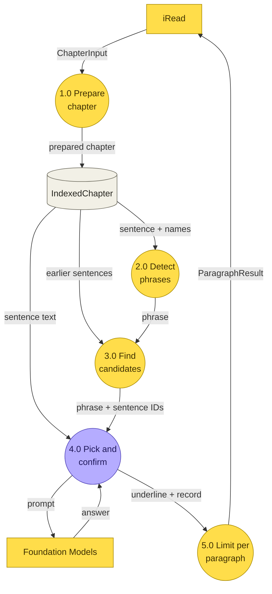
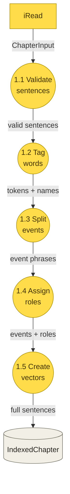
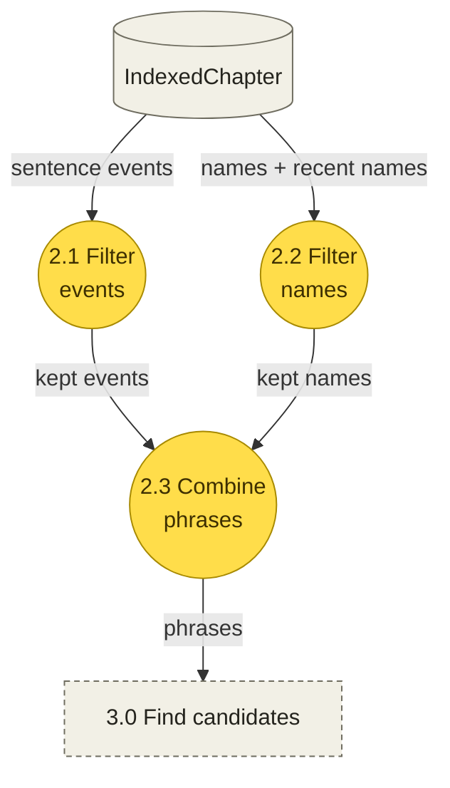
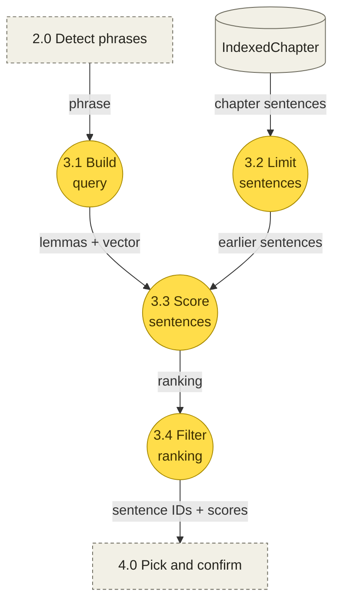
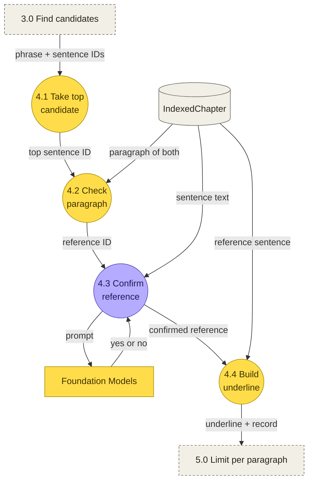
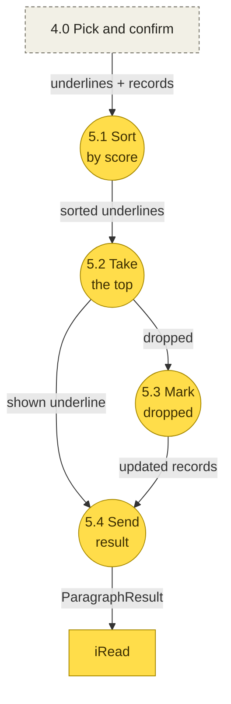

# UnderlineEngine data flow (DFD)

How data moves from one raw chapter to the underlines iRead shows: Level 1 (five processes), then Level 2 (the steps inside each one), each step linked to the code that does it. For the type layers, see [ARCHITECTURE.md](../ARCHITECTURE.md). For the why, see the [design spec](superpowers/specs/2026-10-30-underline-engine-design.md).

- [Notation](#notation)
- [Level 1: five processes](#level-1-five-processes)
- [1. Prepare chapter](#1-prepare-chapter)
- [2. Detect phrases](#2-detect-phrases)
- [3. Find candidates](#3-find-candidates)
- [4. Pick and confirm](#4-pick-and-confirm)
- [5. Limit per paragraph](#5-limit-per-paragraph)
- [Example ParagraphResult](#example-paragraphresult)
- [Data dictionary](#data-dictionary)

## Notation

A DFD answers one question: what data moves where, and which process changes it.

| Shape | Meaning | Here |
|---|---|---|
| Box | External entity, outside the engine | iRead, Foundation Models |
| Circle | Process that changes data, named with a verb | 3.0 Find candidates |
| Cylinder | Data store | `IndexedChapter` |
| Arrow | Data flow, named with a noun | `ChapterInput` |
| Dashed box | A process from another diagram, shown for context | |

Yellow processes use only rules and formulas. Purple ones call Foundation Models.1

Three rules:

1. Every process has an input and an output.
2. Data passes through a process. No arrow goes straight from entity to entity, entity to store, or store to store.
3. A DFD is not a flowchart: no branches or loops. An arrow means data *can* flow there, not that it always does. Where a phrase stops is listed in each step's "Drops as" column.

## Level 1: five processes



| Process | Question it answers | In | Out | Runs |
|---|---|---|---|---|
| 1. Prepare chapter | What is in each sentence? | `ChapterInput` | `IndexedChapter` | Once per chapter |
| 2. Detect phrases | What is worth underlining? | `IndexedSentence`, recent names | `UnderlineCandidate` | Once per sentence |
| 3. Find candidates | Which earlier sentences might explain it? | `UnderlineCandidate`, earlier sentences | `[Candidate]` | Once per phrase |
| 4. Pick and confirm | Which one really explains it? | `UnderlineCandidate`, `[Candidate]`, sentence text | `KeptUnderline?`, `UnderlineRecord` | Once per phrase |
| 5. Limit per paragraph | Which ones are shown? | kept underlines, records | `ParagraphResult` | Once per paragraph |

`IndexedChapter` feeds three processes because it is the store: process 1 writes it once, and processes 2, 3 and 4 each read the part they need.

The loop that drives processes 2 to 5 is `UnderlineCtrl.pass` in [`UnderlineCtrl+Chapter.swift`](../Sources/UnderlineEngine/Pipeline/UnderlineCtrl+Chapter.swift). Processes 3 and 4 for one phrase are `UnderlineCtrl.evaluate` in [`UnderlineCtrl+Evaluate.swift`](../Sources/UnderlineEngine/Pipeline/UnderlineCtrl+Evaluate.swift).

## 1. Prepare chapter

Runs once per chapter, from `UnderlineCtrl.prepare`. The result lives in memory only, and every later process reads it.



| Step | What happens | Code | Knobs |
|---|---|---|---|
| 1.1 | Sort sentences; leave out a duplicate index, a missing paragraph or a range outside its paragraph | `ChapterIndexSvc.index` | |
| 1.2 | Lemma and word class per word, and person, place and organization names (`NLTagger`, or a capital-letter fallback without English models) | `ChapterIndexSvc.tag`, `fallbackTag` | `TaggingKnobs` |
| 1.3 | Cut at commas, quotes and "and/but/or"; keep each chunk with a verb as an event; drop speech tags | `EventSplitter.events` | `EventKnobs` |
| 1.4 | Give each event a `role` from word rules, then derive its `track` from the role | `EventRoles.role`, `EventRoles.track` | `EventKnobs` |
| 1.5 | Turn each sentence into a 512-number vector | `EmbeddingSvc.vector` | |

Steps 1.3 to 1.5 are wired together in `ChapterIndexSvc.prepare` ([`ChapterIndexSvc+Prepare.swift`](../Sources/UnderlineEngine/1-Prepare/ChapterIndexSvc+Prepare.swift)). 1.4 runs inside 1.3: `EventSplitter.events` calls `EventRoles` for every event.

The engine does not split sentences here: iRead sends its own sentence ranges. `SentenceSplitter` is only used by `ChapterInput(plainText:)`, for the harness and tests.

**Role and track.** `role` says what the event does in the story (Trabasso and van den Broek's causal network: `setting`, `initiatingEvent`, `internalResponse`, `goal`, `attempt`, `outcome`, `reaction`). `track` says what a reader may be lost about (Zwaan's event indexing: `character`, `time`, `place`, `cause`, `goal`). Several roles map to one track, so the track can't replace the role. Both are labels only: what gets underlined is the phrase text.

Example, S11: "We've each got a dollar" becomes `setting` / `character`; "wouldn't be much helped by our giving that" becomes `initiatingEvent` / `cause`.

## 2. Detect phrases

Filters each sentence's events and names. `UnderlineCandidate` is created in step 2.3. Everything is in [`UnderlineDetector.swift`](../Sources/UnderlineEngine/2-Detect/UnderlineDetector.swift).



| Step | What happens | Code | Knobs |
|---|---|---|---|
| 2.1 | Keep an event of at least `minPhraseWords` words, not made only of general words, and (for a cause or goal) not already explained by a "because…" clause in its own sentence | `UnderlineDetector.candidates`, `isGeneral`, `EventRoles.reasonClause` | `minPhraseWords`, `generalWords` |
| 2.2 | Keep a person name not mentioned in the last `nameGapSentences` sentences, once per sentence | `UnderlineDetector.candidates`, `UnderlineCtrl.recentNames` | `nameGapSentences` |
| 2.3 | Events then names, each as an `UnderlineCandidate` with its `UnderlineKind` | `UnderlineDetector.candidates` | |

A phrase dropped here leaves no `UnderlineRecord`: it was never evaluated.

Example, S25: of 5 events and 1 name, "I'd say so", "talk about labels" and "was a pickle bottle" pass. "mean libel" and "laughing" are too short, and "Jo" was just mentioned.

## 3. Find candidates

Runs once per phrase. A "candidate" here is an earlier sentence that might explain the phrase, not a phrase that might be underlined. Code: [`CandidateScorer.swift`](../Sources/UnderlineEngine/3-Search/CandidateScorer.swift) and [`ReadBoundary.swift`](../Sources/UnderlineEngine/Shared/ReadBoundary.swift).



| Step | What happens | Code | Knobs | Drops as |
|---|---|---|---|---|
| 3.1 | Build a `SearchQuery`: content lemmas, the phrase's vector, person names in it, a reaction cue; `text`, `track` and `role` copied as they are | `SearchQuery.make` | `stopLemmas` | |
| 3.2 | Only sentences before the phrase's sentence; for a name, only sentences holding that name | `ReadBoundary.searchable`, `CandidateScorer.rank` | | |
| 3.3 | Compare the phrase's vector with each sentence's (meaning) and its lemmas with the sentence's (words); add bonuses for track hints, role links and nearness | `CandidateScorer.rank`, `bonus`, `Cosine.similarity` | `embedWeight`, `wordsWeight`, bonuses, `roleLinks` | |
| 3.4 | Drop a raw score under the floor, then keep the best `maxCandidates` by ranking score | `UnderlineSearch.candidates` | `minRawScore`, `maxCandidates` | `noCandidate` |

There are two scores per sentence:

| Score | Formula (mode `both`) | Used for |
|---|---|---|
| Raw score (`rawScore`) | `0.65 × meaning + 0.35 × words` | The floor in 3.4, and ranking in process 5 |
| Ranking score (`score`) | `0.65 × scaled meaning + 0.35 × scaled words + bonus` | Order in 3.4 |

"Scaled" is min–max over the sentences in the pool, so the ranking score depends on which other sentences are in it.

## 4. Pick and confirm

The only process that calls the model, once per phrase. "Pick" takes search's top candidate; the model only confirms it. Code: `UnderlineCtrl.evaluate` and `modelConfirm` in [`UnderlineCtrl+Evaluate.swift`](../Sources/UnderlineEngine/Pipeline/UnderlineCtrl+Evaluate.swift).



| Step | What happens | Code | Knobs | Drops as |
|---|---|---|---|---|
| 4.1 | Take the first candidate from 3.4 | `UnderlineCtrl.evaluate` | | |
| 4.2 | The reference must be in another paragraph: one in the phrase's own paragraph was just read | `UnderlineGuard.isInSameParagraph` | | `explainedInParagraph` |
| 4.3 | A new session sees only the phrase, its sentence and the one reference (cut to a set length), and answers yes or no | `UnderlineModelSvc.confirm`, `PromptBuilder.confirm`, `PromptBuilder.cut` | `ModelKnobs` | `confirmRejected`, `modelFailed` |
| 4.4 | Move the phrase's range into paragraph coordinates and build the `Underline` with its `AnswerPassage` | `UnderlineGuard.paragraphRange`, `UnderlineCtrl.evaluate` | | `guardRejected` |

Process 4 does not always run in full:

- **Skipped:** a phrase with no candidate stops at 3.4 (`noCandidate`).
- **Partly:** a phrase that fails 4.2 never reaches the model.
- **Without the model:** when Foundation Models is unavailable, `RulesPicker.decide` replaces 4.1 (it can answer none: `pickedNone`) and `RulesPicker.confirm` replaces 4.3 (knobs: `JudgeKnobs`). The record's `path` says which one decided.

Until November 2026 the model also picked among the three candidates, quoting the one it chose. A sweep of chapter 1 without that step gave about the same number of underlines (34 vs 32), slightly fewer judged right (9 vs 11), and a third of the model time, so the step was removed for a simpler flow.

## 5. Limit per paragraph

Runs after every phrase in one paragraph is done. No model call. Code: `UnderlineCtrl.limit` and [`UnderlineLimiter.swift`](../Sources/UnderlineEngine/5-Limit/UnderlineLimiter.swift).



| Step | What happens | Code | Knobs | Drops as |
|---|---|---|---|---|
| 5.1 | Sort the paragraph's kept underlines by their reference's raw score; ties go to the earlier phrase, then by kind | `UnderlineLimiter.apply`, `isBetter` | `UnderlineKnobs.kindOrder` | |
| 5.2 | Take the best `maxPerParagraph`, skipping any that overlaps one already taken | `UnderlineLimiter.apply` | `UnderlineKnobs.maxPerParagraph` | |
| 5.3 | Mark the records of the ones left out | `UnderlineCtrl.limit` | | `densityLimit` |
| 5.4 | Send the shown underlines and every record of the paragraph | `UnderlineCtrl.paragraphResults` | | |

Data in and out of the engine use the same global indexes and UTF-16 ranges: `ChapterInput` comes in once per chapter; `ParagraphResult` goes out once per paragraph.

## Example ParagraphResult

A real result for paragraph 61 of *Little Women* chapter 1, on-device model, `minPhraseWords = 3`, `maxPerParagraph = 1`, `maxCandidates = 3`. Model answers can differ between runs. In the JSON, `range` is written as `[location, length]`.

> "Well, dearies, how have you got on today? There **was so much to do**, getting the boxes ready to go tomorrow, that I didn't come home to dinner. **Has anyone called, Beth**? How is your cold, Meg? Jo, you look tired to death. Come and kiss me, baby."

`underlines`, what iRead shows:

```json
[
  {
    "sentence": 148,
    "paragraph": 61,
    "range": [50, 17],
    "text": "was so much to do",
    "kind": "thing",
    "role": "setting",
    "decidedBy": "model",
    "reference": {
      "sentence": 106,
      "paragraph": 49,
      "range": [124, 147],
      "text": "There is so much to do about the play for Christmas night,\" said Jo, marching up and down, with her hands behind her back, and her nose in the air."
    }
  }
]
```

`records`, every phrase considered:

| Sentence | Phrase | Candidates | Top | Confirm | Result |
|---|---|---|---|---|---|
| S147 | "have you got on today" | S42, S89, S83 | S42 | no | `confirmRejected` |
| **S148** | **"was so much to do"** | S106, S96, S31 | S106 | yes | **shown** |
| S148 | "getting the boxes ready to go tomorrow" | S65, S20, S15 | S65 | no | `confirmRejected` |
| S148 | "that I didn't come home to dinner" | S127, S117, S112 | S127 | no | `confirmRejected` |
| S149 | "Has anyone called, Beth" | S74, S143, S65 | S74 | yes | `densityLimit` |
| S150 | "is your cold, Meg" | S128, S60, S46 | S128 | no | `confirmRejected` |
| S151 | "look tired to death" | S23, S73, S2 | S23 | no | `confirmRejected` |
| S152 | "kiss me, baby" | S103, S29, S120 | S103 | no | `confirmRejected` |

One full record, S149:

```json
{
  "chapterIndex": 0,
  "sentence": 149,
  "phrase": "Has anyone called, Beth",
  "phraseRange": [0, 23],
  "kind": "thing",
  "path": "model",
  "searchModeUsed": "both",
  "embedding": "sentence",
  "candidates": [74, 143, 65],
  "candidateScores": [0.5999, 0.5582, 0.5559],
  "promptSentences": [74, 149],
  "pickedSentence": 74,
  "confirm": { "explains": true, "evidence": "Elizabeth, or Beth, as everyone called her, ..." },
  "kept": false,
  "dropped": "densityLimit",
  "times": { "searchMs": 5, "confirmMs": 1079 }
}
```

- Two phrases passed process 4 (S148, S149). With one underline per paragraph only S148 is shown, the one whose reference has the highest raw score.
- `promptSentences` lists every sentence that went into a prompt. None may be after the phrase's own sentence: that is the no-spoiler rule.
- `ParagraphResult` is not `Codable`. iRead turns `underlines` into its own `SavedUnderline` and keeps `records` as they are.

## Data dictionary

The labels on the arrows describe the data. This table ties them to Swift types.

| Label | Swift | What it holds | Defined in |
|---|---|---|---|
| ChapterInput | `ChapterInput` | Paragraph texts and each sentence's range | `Shared/Models/ChapterInput/InputModels.swift` |
| prepared chapter | `IndexedChapter` | Every sentence with tokens, names, events and vector. In memory only | `Shared/Models/ChapterInput/IndexedChapter.swift` |
| sentence + names | `IndexedSentence`, `Set<String>` | One sentence, and the person names of the sentences before it | `IndexedChapter.swift` |
| event phrases | `EventPhrase` | Text, range, `role`, `track` | `Shared/Models/ChapterInput/EventModels.swift` |
| phrase | `UnderlineCandidate` | Sentence index, the phrase, its kind | `2-Detect/UnderlineDetector.swift` |
| lemmas + vector | `SearchQuery` | What one phrase is searched with | `Shared/Models/Candidate.swift` |
| earlier sentences | `[IndexedSentence]` | Sentences before the phrase (`ReadBoundary`) | |
| ranking | `SearchResult` | Every earlier sentence, scored | `Shared/Models/Candidate.swift` |
| phrase + sentence IDs | `UnderlineCandidate`, `[Candidate]` | The phrase, and indexes and scores of its candidates, no text | `Shared/Models/Candidate.swift` |
| sentence text | `IndexedSentence.text`, `IndexedText` | Sentence text for a prompt | `4-PickConfirm/UnderlineModelSvc.swift` |
| yes or no | `ModelConfirm` | The model's confirm, with evidence | `4-PickConfirm/UnderlineModelSvc.swift` |
| underline | `Underline`, inside `KeptUnderline` | A phrase that passed, with its `AnswerPassage` | `Shared/Models/UnderlineModels.swift` |
| record | `UnderlineRecord` | What happened to one phrase, with `DropReason` when it stopped | `Shared/Models/UnderlineRecord.swift` |
| ParagraphResult | `ParagraphResult` | One paragraph's shown underlines and every record | `Shared/Models/UnderlineRecord.swift` |
