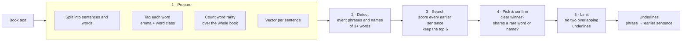
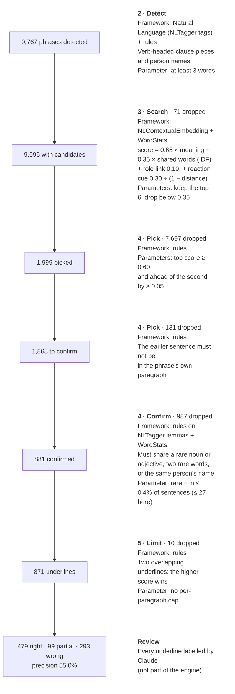

# UnderlineEngine pipeline

UnderlineEngine reads a novel and underlines phrases that call back to an earlier sentence, so the reader can tap and see where it came from. Everything runs **on the device**: Apple's Natural Language framework for tagging and embeddings, and hand-written rules for the decisions. There is no server and no model call.

This page has four views of the same engine:

1. [Pipeline](#1-pipeline): the stages, what each one takes and gives, and what does the work.
2. [Funnel](#2-funnel-one-book-in-numbers): how many phrases survive each stage on one real book.
3. [Walkthrough](#3-walkthrough-prepare-on-one-paragraph): what Prepare produces for one paragraph.
4. [Worked example](#4-worked-example): one underline traced through every stage, and one failure.

Numbers come from the full-book run of *The Adventures of Sherlock Holmes* (run R22 in [result.md](result.md), current configuration). Every underline was reviewed by Claude as right, partial or wrong.

## 1. Pipeline

| Stage | Takes | Gives | Does the work |
|---|---|---|---|
| **1 · Prepare** | the book's chapters | sentences with tagged words, a vector per sentence, word rarity for the whole book | `NLTagger` (lemma, word class, names); `NLContextualEmbedding` (sentence vectors, `NLEmbedding` as fallback); `WordStats` (how many sentences contain each word) |
| **2 · Detect** | one sentence | candidate phrases: event phrases (a verb with its words) and person names, at least 3 words | rules over the tagged words; each event phrase gets a story role (setting, goal, attempt, reaction…) |
| **3 · Search** | one phrase | the earlier sentences ranked by how well they could explain it; the top 6 | score = 65% meaning (vector similarity) + 35% shared words weighted by rarity (IDF), plus small bonuses for a matching story role or a "suddenly / immediately" cue; sentences under 0.35 are dropped |
| **4 · Pick & confirm** | the ranking | at most one earlier sentence, or none | **pick:** the top sentence must score ≥ 0.60 and lead the second by ≥ 0.05, and must not be in the phrase's own paragraph · **confirm:** the two must share a rare noun or adjective (in ≤ 0.4% of the book's sentences), two rare words, or the same person's name |
| **5 · Limit** | every kept underline of a paragraph | the ones shown | when two underlines overlap, the higher score wins |

What makes it work on a phone: the heavy part (tagging and vectors) runs once per book; each phrase is then scored with plain arithmetic. The whole of *Sherlock Holmes* (6,887 sentences) takes under 5 minutes on a Mac, about 40 ms per sentence.

### Method

Notation: a book is a sequence of sentences $s_1, \dots, s_N$. For a sentence $s$, $L(s)$ is its set of **content lemmas** (nouns, verbs and adjectives, minus a short stop list such as *be*, *have*, *say*), each paired with its word class. A candidate phrase is written $q$, and the sentence it sits in $s_q$.

#### 1.1 Prepare

**Purpose.** Turn raw text into a representation that every later step can query cheaply. All of it is computed once per book.

**Procedure.**
1. **Sentence segmentation** with `NLTokenizer(unit: .sentence)`. Sentences are numbered within their chapter and keep their paragraph index.
2. **Morphological tagging** with `NLTagger` (schemes `.lemma` and `.lexicalClass`): every word gets its lemma and word class, so *drifted*, *drifts* and *drift* are one unit.
3. **Named-entity tagging** with `NLTagger` (scheme `.nameType`): person, place and organization names.
4. **Sentence embedding** with `NLContextualEmbedding`. The token vectors of a sentence are averaged into one 512-dimensional vector $v(s)$. The vectors are then **centred**: the mean vector $\mu$ of every fifth sentence of the book is subtracted, so that what all sentences of the book share (style, period, narrator) does not dominate the similarity.
5. **Book-level word statistics** (`WordStats`). For each lemma $\ell$, the document frequency is the number of sentences that contain it:

$$\mathrm{df}(\ell) = \lvert \{\, s : \ell \in L(s) \,\} \rvert, \qquad \mathrm{idf}(\ell) = \ln\!\Big(1 + \frac{N}{\mathrm{df}(\ell)}\Big)$$

A lemma is **rare** when $\mathrm{df}(\ell) \le \max(2,\ \lfloor 0.004\,N \rfloor)$, i.e. it appears in at most 0.4% of the book's sentences (27 sentences for *Sherlock Holmes*).

**Rationale.** Counting over the whole book, not one chapter, makes rarity a property of the novel: a word that recurs only in one story still counts as rare. The IDF weight follows the standard information-retrieval intuition that sharing an uncommon word is stronger evidence than sharing a common one.

#### 1.2 Detect

**Purpose.** Choose the spans of text that a reader might want to trace back.

**Procedure.**
1. **Clause chunking.** Each sentence is cut at punctuation (`, ; : — " ( )`) and at the coordinators *and / but / or*.
2. **Event phrases.** In each chunk, the phrase runs from the first verb to the end of the chunk. A preceding cue adverb (*suddenly*, *immediately*), a contracted pronoun (*I'm*) or a relative opener (*who*, *where*) is kept with it; a chunk without a verb is attached to the phrase before it.
3. **Causal role.** Each event phrase is labelled with a causal role after Trabasso and van den Broek (1985): setting, initiating event, internal response, goal, attempt, reaction or outcome, from cue words and verb lists.
4. **Names.** Person names found in 1.1 are added as phrases of their own.
5. **Filters.** A phrase is kept only if it has **at least 3 words**, is not made only of filler words, is not a speech tag (*said Meg*), is not a name already mentioned in the previous 30 sentences, and is not already explained inside its own sentence by a causal clause (*because…*, *since…*).

**Rationale.** A verb-headed span describes something that happens, which is what a later passage refers back to. The 3-word minimum removes bare names and fragments such as *sat up*, which link easily but tell the reader little.

#### 1.3 Search

**Purpose.** For each phrase $q$, rank the earlier sentences by how likely each one is the passage it refers back to.

**Procedure.** The candidate pool is every sentence before $s_q$ in the same chapter; for a name, only the sentences that mention it. Each candidate $s$ receives two similarities:

$$\mathrm{sem}(q, s) = \operatorname{clip}_{[0,1]}\big(0.703 \cdot \cos(v(q), v(s)) + 0.295\big)$$

$$\mathrm{lex}(q, s) = \frac{\sum_{\ell \in L(q) \cap L(s)} \mathrm{idf}(\ell)}{\sum_{\ell \in L(q)} \mathrm{idf}(\ell)}$$

$\mathrm{sem}$ compares meaning; the linear rescaling maps `NLContextualEmbedding` cosines onto the range of the older `NLEmbedding`, so the thresholds below keep their meaning. $\mathrm{lex}$ is the share of the phrase's word weight that the candidate also contains. They are combined into a raw score, with meaning weighted higher:

$$\mathrm{raw}(q, s) = 0.65 \cdot \mathrm{sem}(q, s) + 0.35 \cdot \mathrm{lex}(q, s)$$

For ranking only, two small priors are added: $+0.10$ if a causal role of $s$ typically precedes the role of $q$ (e.g. a goal before an attempt), and $+0.30 / (1 + d)$ when $q$'s sentence carries a reaction cue, where $d$ is the distance in sentences. Candidates with $\mathrm{raw} < 0.35$ are discarded and the top **6** are kept.

**Rationale.** Meaning alone matches sentences that are merely about the same topic; shared rare words alone miss paraphrases. The weighted sum lets either signal carry a link, with the stricter checks left to the next step.

#### 1.4 Pick and confirm

**Purpose.** Decide whether the best candidate is good enough to show, and check the link on evidence the score does not already use.

**Pick.** Let $s^\ast$ be the top-ranked candidate and $s_2$ the runner-up. The link is accepted only if

$$\mathrm{raw}(q, s^\ast) \ge 0.60 \quad\text{and}\quad \mathrm{raw}(q, s^\ast) - \mathrm{raw}(q, s_2) \ge 0.05,$$

$s^\ast$ is not a **stub** (a sentence of 3 words or fewer, such as *"Jo!"*, or a short speech tag of up to 6 words, such as *"cried Amy."*), and $s^\ast$ lies outside $q$'s own paragraph, where the reader can already see it.

**Confirm.** Let $W$ be the content words that $q$ and $s^\ast$ share, matched on both lemma and word class (so the noun *walk* does not match the verb *walk*). The link is confirmed if at least one holds:
- $W$ contains a **rare noun or adjective**;
- $W$ contains **two or more rare lemmas** of any class;
- $q$ and $s^\ast$ mention **the same person**.

**Rationale.** The threshold and margin reject phrases with no clearly best antecedent, which is most of them (79% on *Sherlock Holmes*). Confirmation adds a lexical check that a close-but-unrelated sentence cannot pass by meaning alone. Its known limit is the reverse case: two sentences that share a rare word but describe different events are still confirmed (see section 4).

#### 1.5 Limit

**Purpose.** Produce a readable page: one underline per stretch of text.

**Procedure.** Within a sentence, accepted phrases may overlap (an event phrase and a name inside it). They are sorted by score and taken greedily; a phrase that overlaps one already taken is dropped. Ties go to the earlier sentence, then the earlier position, then the shorter phrase. There is no cap on underlines per paragraph.

**Rationale.** An earlier version allowed one underline per paragraph; removing the cap kept about 20% more right links at the same precision, while the overlap rule still prevents two underlines on the same words.

#### References

- Apple. Natural Language framework: `NLTokenizer`, `NLTagger`, `NLContextualEmbedding`. developer.apple.com/documentation/naturallanguage

## 2. Funnel: one book in numbers

*The Adventures of Sherlock Holmes*, 12 stories, 6,887 sentences, 104,348 words.

| | Phrases | Share of detected |
|---|---|---|
| Detected | 9,767 | 100% |
| Had a candidate | 9,696 | 99.3% |
| Clear winner picked | 1,999 | 20.5% |
| Not in the same paragraph | 1,868 | 19.1% |
| Confirmed | 881 | 9.0% |
| **Shown** | **871** | **8.9%** |
| Right (Claude's review) | 479 | 4.9% |

**Against the target.** The iRead seed that Claude made by hand for the same book has 516 links, 95% right. The engine finds about as many right links (479 vs 492) but mostly different ones, and adds 293 wrong ones. Most wrong links are word echoes: the two sentences share a word but not an event. See the [Target section of result.md](result.md#target).

## 3. Walkthrough: Prepare on one paragraph

What step 1 (Prepare) produces for the opening of *A Scandal in Bohemia* (chapter 1, sentences 11–13)

All of Prepare runs on Apple's **Natural Language** framework (on-device, part of iOS and macOS), plus the engine's own word counting:

| Sub-step | Framework | API |
|---|---|---|
| 1a · Split into sentences | Natural Language | `NLTokenizer(unit: .sentence)` |
| 1b · Tag every word | Natural Language | `NLTagger`, schemes `.lemma` and `.lexicalClass` |
| 1c · Find names | Natural Language | `NLTagger`, scheme `.nameType` (person, place, organization) |
| 1d · Vector per sentence | Natural Language | `NLContextualEmbedding(language: .english)`; fallback `NLEmbedding.sentenceEmbedding(for: .english)` |
| 1e · Word rarity | UnderlineEngine (Swift) | `WordStats`: counts sentences per lemma over the whole book |

> I had seen little of Holmes lately. My marriage had drifted us away from each other. My own complete happiness, and the home-centred interests which rise up around the man who first finds himself master of his own establishment, were sufficient to absorb all my attention, while Holmes, who loathed every form of society with his whole Bohemian soul, remained in our lodgings in Baker Street, buried among his old books, and alternating from week to week between cocaine and ambition, the drowsiness of the drug, and the fierce energy of his own keen nature.

### 1a · Split into sentences

*Framework: Natural Language · `NLTokenizer(unit: .sentence)` in `SentenceSplitter`*

The text becomes three sentences, numbered within the chapter (678 sentences in chapter 1, 6,887 in the book):

| # | Sentence |
|---|---|
| 11 | I had seen little of Holmes lately. |
| 12 | My marriage had drifted us away from each other. |
| 13 | My own complete happiness, … the fierce energy of his own keen nature. |

### 1b · Tag every word

*Framework: Natural Language · `NLTagger` with `.lemma` and `.lexicalClass` in `ChapterIndexSvc`*

`NLTagger` gives each word its base form (lemma) and word class. Sentence 12:

| Word | Lemma | Class |
|---|---|---|
| My | my | Determiner |
| marriage | marriage | Noun |
| had | have | Verb |
| drifted | **drift** | Verb |
| us | **i** | Pronoun |
| away | away | Adverb |
| from | from | Preposition |
| each | each | Determiner |
| other | other | Adjective |

The lemma is what makes "drifted", "drifts" and "drift" count as one word later. A few lemmas from sentence 13: *loathed → loathe*, *lodgings → lodging*, *buried → bury*, *alternating → alternate*, *our → my*, *himself → he*.

### 1c · Find names

*Framework: Natural Language · `NLTagger` with `.nameType` in `ChapterIndexSvc`*

| Sentence | Names |
|---|---|
| 11 | *Holmes* (person) |
| 12 | none |
| 13 | *Holmes* (person) · *Baker Street* (place) |

### 1d · Turn each sentence into a vector

*Framework: Natural Language · `NLContextualEmbedding` in `EmbeddingSvcContextual` (the model's assets are downloaded once by the system; `NLEmbedding` is the fallback)*

`NLContextualEmbedding` reads each whole sentence and returns **512 numbers** that stand for its meaning. Sentence 12, first five values: `0.020, -0.001, -0.013, 0.009, 0.068, …`. Sentences with similar meaning get similar numbers, which is what the meaning part of the search compares later. All vectors are centred on the book, so the numbers say how a sentence differs from the book's average sentence.

### 1e · Count how rare each word is in the whole book

*Framework: none (the engine's own Swift code) · `WordStats`, using the lemmas and word classes from 1b*

For every content word (noun, verb, adjective), Prepare counts how many of the book's 6,887 sentences contain it. A word in **27 sentences or fewer** (0.4% of the book) counts as **rare**. Rarity also gives each word a weight (IDF): the rarer the word, the more sharing it counts in the search.

| Word | In how many sentences | Weight (IDF) | |
|---|---|---|---|
| holmes | 460 | 2.77 | common |
| man | 319 | 3.12 | common |
| see | 320 | 3.11 | common |
| street | 89 | 4.36 | common |
| baker | 42 | 5.11 | common |
| week | 42 | 5.11 | common |
| marriage | 27 | 5.55 | **rare** (just) |
| attention | 27 | 5.55 | **rare** (just) |
| book | 20 | 5.84 | **rare** |
| lodging | 9 | 6.64 | **rare** |
| drug | 5 | 7.23 | **rare** |
| drift | 4 | 7.45 | **rare** |
| cocaine | 3 | 7.74 | **rare** |
| loathe | 1 | 8.84 | **rare** |
| ambition | 1 | 8.84 | **rare** |

So after Prepare, sentence 13 is stored as: its text, 80 tagged words, two names, a 512-number vector, and a rarity weight for each of its 38 content words, 27 of them rare. Everything the later steps need is now ready; the slow work (tagging and vectors) is never repeated.

## 4. Worked example

### A right link

> "We **waited long for news of the Lone Star of Savannah**, but none ever reached us." (*The Five Orange Pips*)

| Stage | What happens |
|---|---|
| 1 · Prepare | Tagged words include *news*, *Lone*, *Star*, *Savannah* (nouns). *Savannah* and *Lone Star* appear in only a handful of the book's sentences, so they are rare. |
| 2 · Detect | The event phrase "waited long for news of the Lone Star of Savannah" (role: attempt) is a candidate. |
| 3 · Search | Top 3 of the earlier sentences:  0.77 · *Then he sealed it and addressed it to "Captain James Calhoun, Barque Lone Star, Savannah, Georgia."*  0.68 · *"The Lone Star had arrived here last week.*  0.66 · *…when I found that the barque Lone Star was there in January, '85…* |
| 4 · Pick | 0.77 is above 0.60 and leads by 0.09. It is 30 sentences back, in another paragraph. **Picked.** |
| 4 · Confirm | They share the rare nouns *Lone Star* and *Savannah*. **Confirmed.** |
| 5 · Limit | No overlapping underline. **Shown.** |

The reader taps the phrase and sees the letter Holmes addressed to the *Lone Star* earlier in the story.

### A wrong link (the main weakness)

> "**I am afraid so.**" (*The Red-Headed League*)

| Stage | What happens |
|---|---|
| 3 · Search | Top: 0.85 · *"I was afraid that you were engaged."*, 459 sentences earlier. The next is only 0.56. |
| 4 · Pick | 0.85 is far ahead. **Picked.** |
| 4 · Confirm | They share the adjective *afraid*, which is rare enough in this book. **Confirmed.** |
| Review | **Wrong.** Same word, different moment: a word echo. |

Every check passed because the engine judges words, not events. Closing this gap, without losing the right links, is the open problem; see [result.md](result.md).

## Glossary

| Term | Meaning in this document |
|---|---|
| **Phrase** | The piece of a sentence that may get underlined: an event phrase (see below) or a person's name, at least 3 words long. |
| **Event phrase** | A phrase that starts at a verb and runs to the end of its chunk, e.g. *had drifted us away from each other*. It describes something that happens. |
| **Chunking** | Cutting a sentence into pieces at punctuation (`, ; : — " ( )`) and at *and / but / or*, before phrases are made. It decides **where a phrase starts and ends**. It has nothing to do with search: `sem` and `lex` always compare the whole phrase with the whole earlier sentence. |
| **Chunk** | One piece of a sentence after chunking. Each chunk that contains a verb gives one event phrase. |
| **Lemma** | The base form of a word: *drifted* → *drift*, *lodgings* → *lodging*, *our* → *my*. Words are compared by lemma, so different forms of a word count as the same word. |
| **Word class** | Noun, verb, adjective, adverb, etc., given by `NLTagger`. Two words only count as shared when lemma and word class both match. |
| **Content lemma** | The lemma of a noun, verb or adjective, excluding a stop list of very common verbs (*be, have, do, say, get, go, make, let* and modal verbs). Only these are counted and compared. |
| **Named entity** | A person, place or organization name found by `NLTagger`, e.g. *Holmes* (person), *Baker Street* (place). |
| **Vector (embedding)** | 512 numbers that `NLContextualEmbedding` computes for a sentence or phrase; texts with similar meaning get similar vectors. |
| **Centring** | Subtracting the book's average vector (taken from every fifth sentence) from each vector, so similarities reflect what is specific to a sentence rather than the book's overall style. |
| **Cosine similarity** | How closely two vectors point the same way, from −1 to 1. The basis of `sem`. |
| **df (document frequency)** | In how many sentences of the book a lemma appears. |
| **IDF (inverse document frequency)** | A word weight, `ln(1 + N / df)`: high for rare words, low for common ones. Used to weight shared words in `lex`. |
| **Rare word** | A lemma in at most 0.4% of the book's sentences (27 for *Sherlock Holmes*), with a minimum of 2. |
| **Candidate** | An earlier sentence that the search considers as the answer for a phrase. The top 6 are kept. |
| **sem** | Meaning similarity between the phrase and a candidate: the rescaled cosine of their vectors. |
| **lex** | Word overlap between the phrase and a candidate: the share of the phrase's IDF weight that the candidate also contains. |
| **raw score** | `0.65 × sem + 0.35 × lex`. The thresholds (floor 0.35, pick 0.60, margin 0.05) are applied to this score. |
| **Bonus (prior)** | A small extra added only for ranking: +0.10 when the causal roles fit, +0.30 ÷ (1 + distance) after a reaction cue. |
| **Causal role** | The part an event plays in a story, after Trabasso and van den Broek (1985): setting, initiating event, internal response, goal, attempt, reaction, outcome. |
| **Reaction cue** | A word such as *suddenly*, *immediately*, *then*, *instantly*, signalling that the event reacts to what came just before. |
| **Floor** | The minimum raw score (0.35) for a sentence to stay a candidate. |
| **Threshold** | The minimum raw score (0.60) the best candidate needs to be picked. |
| **Margin** | How far (at least 0.05) the best candidate must be ahead of the second best, so the choice is clear. |
| **Stub** | An earlier sentence too thin to serve as an answer: 3 words or fewer (*"Jo!"*), or a short speech tag of up to 6 words that starts with a speech verb (*"cried Amy."*). Stubs are skipped as candidates. |
| **Speech tag** | The part that attributes dialogue, e.g. *said Meg*, *cried the King*. Never a phrase and never an answer. |
| **Confirm** | The final check on a picked link: the phrase and the sentence must share a rare noun or adjective, two rare words, or the same person's name. |
| **Overlap** | Two phrases in the same sentence that cover some of the same words; only the higher-scoring one is shown. |
| **Antecedent** | The earlier sentence a phrase refers back to; the sentence shown when the reader taps an underline. |
| **Word echo** | A wrong link where the phrase and the earlier sentence share a word but describe different events, e.g. *I am afraid so* → *I was afraid that you were engaged*. |
| **Precision** | Right links ÷ all links shown. |
| **Right / partial / wrong** | Claude's label for each link: the earlier sentence is the right answer, related but not exact, or unrelated. |

## More detail

- [result.md](result.md): every run, its parameters and its results.
- [DFD-v2.md](DFD-v2.md): every process and data store, with the code that implements it.
